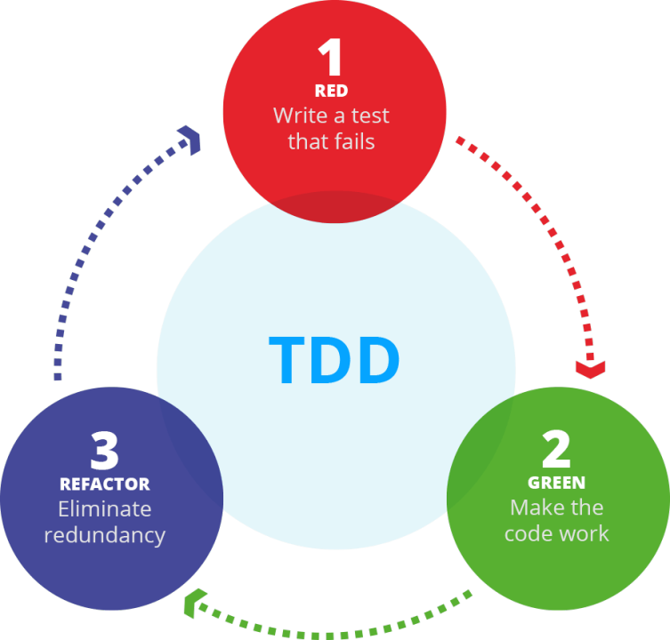
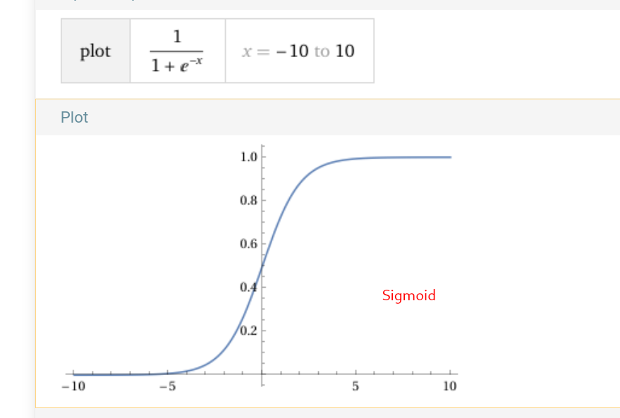
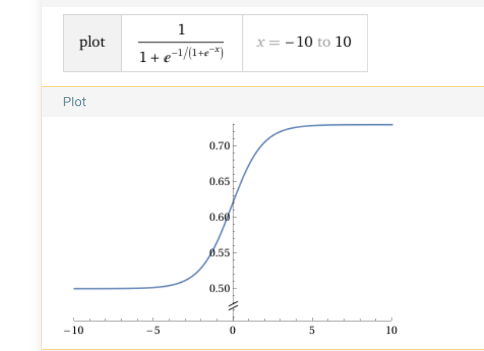

# Test driven development



Test Driven Development to sposób wytwarzania oprogramowania, w którym przechodzimy między trzema stanami:
- Czerwony - nieprzechodzące testy
- Zielony - przechodzące testy 
- Niebieski - modyfikacja kodu (refaktoryzacja)

Jako przykład, weźmy klasę sprawdzającą czy hasło jest dostatecznie silne. 
## PasswordValidator

Zaczynamy od napisanie testu - łatwe i trudne hasło:
[KOD](ex1.py)
```python
class PasswordValidator:
    def is_strong(self, password: str) -> bool:
        return False

def test_strong_password():
    assert not PasswordValidator().is_strong("dupa")
    assert PasswordValidator().is_strong("!fjaosoi480AASDSADjfbbaslPJSFDPOSJf")
```
Mająć nieprzechodzący test, tworzymy minimalną implementację, która będzie przechodziła - hasła dłuższe niż 7 znaków uznajemy za bezpieczne:
[KOD](ex2.py)
```python
class PasswordValidator:
    def is_strong(self, password: str) -> bool:
        if len(password) < 8:
            return False
        return True
```
Następnie, dobudowujemy następne testy - ciąg znaków od 1 do 8 nie jest bezpieczny:
[KOD](ex3.py)
```python
def test_weak_password():
    assert not PasswordValidator().is_strong("12345678")
```
Kod refaktorujemy - dodajemy sprawdzenia czy hasło zawiera cyfry, litery małe i duże:
```python
class PasswordValidator:
    def is_strong(self, password: str) -> bool:
        if len(password) < 8:
            return False
        return self._contains_uppercase(password) and self._contains_lowercase(password) and self._contains_number(password)

    def _contains_uppercase(self, password: str) -> bool:
        return any(ch.isupper() for ch in password)

    def _contains_lowercase(self, password: str) -> bool:
        return any(ch.islower() for ch in password)

    def _contains_number(self, passsword: str):
        return any(ch.isdigit() for ch in passsword)
```
Znowu zabrakło kolejnego przypadku - hasła bardzo długie, niezawierające znaków specjalnych też są bezpieczne. Tworzymy test, uzupełniamy implementację... I tak w kółko:
[KOD](ex4.py)
```python
class PasswordValidator:
    def is_strong(self, password: str) -> bool:
        if len(password) < 8:
            return False
        if len(password) > 16:
            return True
        return self._contains_uppercase(password) and self._contains_lowercase(password) and self._contains_number(password)

def test_long_password():
    assert PasswordValidator().is_strong("bardzosilnehaslojestspoko")
```
## Real-life example

Jako przykład `real_life`, zobaczmy poprawkę, która usuwała z modelu funkcję `Sigmoid`, która została "wciągnięta" do modelu:
```diff
-  conf = sigmoid(cls_out)
+  conf = cls_out
```
Oryginalnie funkcja Sigmoid zamienia wartości ujemne na wartości bliskie zeru, a duże wartości dodatnie na wartości bliskie jedynki.


Jeśli funkcja zostanie wywołana dwa razy, wartości zmienią się na wartości w zakresie 0.5-0.8:


Ponieważ funkcja używana jest w detektorze, model fałszywie będzie wykrywał mnóstwo twarzy. Test może więc wyglądać w taki sposób:
```python
def test_wicket_quantized():
    with tempfile.TemporaryDirectory() as tmpdirname:
        default_confidence_threshold = 0.1
        default_nms_threshold = 0.4
        img_path = Path("./example_dataset/kajetan.jpg")
        img = Image.open(img_path).convert("RGB")
        img = np.array(img)

        # TYLKO TA KLASA SIĘ ZMIENIŁA - 
        detector = DetectorWicketQuantized(
            tmpdirname,
            False,
            confidence_threshold=default_confidence_threshold,
            nms_threshold=default_nms_threshold,
            delegate_file=None,
            model_path=str( ROOT_DIR / "model_files/face-det-quant-alpha-portrait-v0_10.tflite"),
        )

        preds, padded_image = detector.detect_faces(img, str(img_path))
        assert len(preds) == 1 # NAJWAŻNIEJSZE SPRAWDZENIE - CZY JEST JEDNA TWARZ
```

Lub, alternatywnie - możemy dopisać do istniejącej fixtury dodatkowy model:
```python
@pytest.fixture(
    params=[
        (Embedder.RESNET400, Detector.RETINA256),
        (Embedder.WICKET, Detector.WICKET),
        (Embedder.WICKET_QUANTIZED, Detector.WICKET_QUANTIZED),
    ],
    scope="module",
)
```

Konkluzja: poprawki zawsze zaczynamy od pisania testu.


